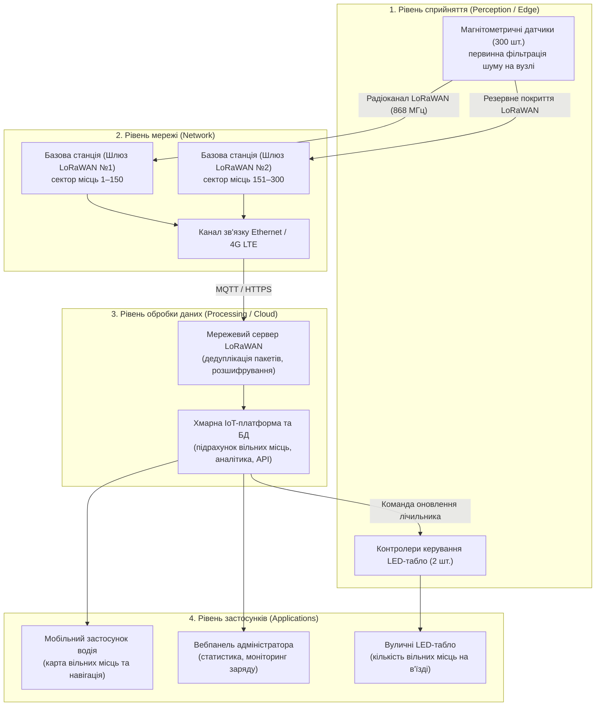

# Проєктування IoT-системи «Розумне паркування» на 300 місць (Варіант 3)

**Дисципліна:** Технології IoT та SMART-технології  
**Виконав:** *Самойленко Євген, alk-43*  

---

## 1. Загальна концепція системи

Мета проєкту — спроєктувати систему моніторингу зайнятості для міського відкритого паркінгу на **300 паркомісць**. 

На практиці система вирішує просту, але важливу проблему: водій ще на під'їзді до паркінгу бачить на вуличному табло або у мобільному додатку точну кількість вільних місць і сектор, куди варто їхати, щоб не кружляти територією в пошуках вільного місця. Адміністратор паркінгу, своєю чергою, отримує статистику завантаженості та бачить технічний стан обладнання.

---

## 2. Спосіб визначення зайнятості місця: порівняння двох типів датчиків

Щоб система знала, вільне місце чи зайняте, на кожному з 300 місць встановлюється окремий сенсор. Для реалізації розглянуто два найпоширеніші технологічні підходи:

| Критерій порівняння | Магнітометричний датчик (в асфальт) | Ультразвуковий датчик (на стелю/опору) |
| :--- | :--- | :--- |
| **Принцип роботи** | Фіксує зміну магнітного поля Землі, коли над ним з'являється велика металева маса (автомобіль). | Вимірює час повернення ультразвукового сигналу: якщо відстань до перешкоди зменшилась — місце зайняте. |
| **Де встановлюється** | Монтується в дорожнє покриття (асфальт/бруківку) по центру паркомісця. | Кріпиться на стелю або високу консольну балку над кожним місцем. |
| **Стійкість до погоди** | Дуже висока (герметичний корпус IP68, працює під снігом, дощем та брудом). | Низька для вулиці (сніг, злива чи обмерзання спотворюють сигнал; підходить переважно для критих паркінгів). |
| **Живлення та автономність** | Працює від вбудованої батареї 5–7 років без заміни та без прокладання кабелів. | Потребує постійного дротового живлення (12–24 В) та кабельних трас до кожного місця. |
| **Складність монтажу** | Потрібне свердління отвору в асфальті (~10–15 хв на 1 місце), але без траншей під кабелі. | Дорогий монтаж на вулиці через необхідність будівництва опор і прокладання кілометрів дротів. |

**Висновок щодо вибору:** для міського паркінгу на 300 місць обрано **бездротові магнітометричні датчики** (з додатковим інфрачервоним або радарним підтвердженням для уникнення хибних спрацювань). Це значно дешевше в монтажі, ніж тягнути дроти до 300 точок, і гарантує стабільну роботу взимку під снігом.

---

## 3. Таблиця складу системи

| Назва пристрою | Кількість | Що вимірює або робить | Де фізично розміщено |
| :--- | :---: | :--- | :--- |
| **Магнітометричний датчик паркування** | 300 шт. | Визначає наявність автомобіля над місцем та передає статус (`вільно` / `зайнято`) і рівень заряду батареї. | Вмонтовано в асфальт по центру кожного з 300 паркомісць. |
| **Базова станція (шлюз LoRaWAN)** | 2 шт. | Приймає радіосигнали від усіх 300 датчиків і пересилає їх через інтернет на хмарний сервер. | На високих опорах освітлення (висота 4–5 м) у протилежних кінцях паркінгу. |
| **Світлодіодне інформаційне табло** | 2 шт. | Відображає кількість вільних місць у реальному часі та стрілки напрямку руху для водіїв. | На в'їзді до паркінгу та на головному роздоріжжі всередині території. |
| **Контролер керування табло** | 2 шт. | Отримує актуальну цифру вільних місць із сервера та оновлює зображення на світлодіодному екрані. | У герметичній монтажній шафі всередині корпусу кожного табло. |
| **Хмарний сервер (платформа обробки)** | 1 (віртуальний) | Зберігає стани всіх 300 місць, рахує вільні місця, веде історію та надає API для додатків. | У віддаленому дата-центрі (хмарна інфраструктура). |
| **Мобільний застосунок та вебпанель** | Для користувачів | Показують водіям карту вільних місць, а адміністратору — аналітику та сповіщення про несправності. | На смартфонах водіїв та комп'ютері адміністратора паркінгу. |

---

## 4. Чотирирівнева архітектура системи (діаграма Mermaid)

Архітектура системи побудована за класичною чотирирівневою моделлю IoT (відповідно до рекомендацій ITU-T Y.2060):

---

## 5. Мережева топологія та вибір протоколу зв'язку

Для об'єднання **300 паркувальних датчиків** обрано бездротову технологію **LoRaWAN** із мережевою топологією **«зірка»** (точніше «зірка зірок», де кожен датчик напряму спілкується зі шлюзами без ретрансляції через сусідні датчики).

**Чому саме LoRaWAN для 300 вузлів:**
* **Наднизьке енергоспоживання:** датчик надсилає мікроскопічний пакет даних (лише кілька байтів: ID місця + статус `0/1` + заряд батареї) тільки в момент зміни стану (коли авто заїхало або виїхало) та раз на добу як контрольний сигнал. Завдяки цьому один елемент живлення працює **5–7 років**.
* **Велика дальність і пробивна здатність:** на частоті 868 МГц сигнал стабільно долає сотні метрів міської забудови та проходить навіть крізь припарковані поруч автомобілі, де звичайний Wi-Fi або Bluetooth швидко втрачають зв'язок.
* **Масштабованість:** один канал шлюзу легко обслуговує сотні рідких повідомлень без колізій та перевантаження ефіру.
* **Відсутність витрат на кабелі:** на відміну від дротових інтерфейсів (RS-485 / Ethernet), не потрібно різати асфальт по всьому паркінгу для прокладання кабелів.

---

## 6. Розрахунок кількості шлюзів та вибір їх розміщення

1. **Пропускна здатність і радіус дії:** один стандартний 8-канальний базовий шлюз LoRaWAN у міських умовах забезпечує впевнений прийом у радіусі **1–2 км** та здатний обробити тисячі пристроїв, якщо вони передають дані лише при зміні події. Тобто технічно з навантаженням від 300 місць впорався б навіть **1 шлюз**.
2. **Інженерне рішення — 2 шлюзи для надійності:** у проєкт закладено **2 базові станції LoRaWAN**. Вони працюють за принципом взаємного резервування (в архітектурі LoRaWAN датчик не прив'язаний жорстко до одного шлюзу — його пакет приймають усі шлюзи в зоні досяжності, а мережевий сервер автоматично відкидає дублікати). Якщо один шлюз вийде з ладу чи зникне живлення на одній опорі, другий автоматично підхопить усі 300 місць без втрати працездатності паркінгу.
3. **Розміщення:** шлюзи монтуються на існуючих опорах освітлення або фасадах будівель на висоті **4–5 метрів** у протилежних кінцях паркінгу. Така висота прибирає перешкоди у вигляді дахів позашляховиків і мікроавтобусів та забезпечує пряму видимість до всіх 300 датчиків.

---

## 7. Розміщення обробки даних: Edge та Хмара

У системі використано гібридну модель розподілу обчислень (**Edge + Cloud**):

* **На рівні пристрою (Edge — мікроконтролер самого датчика):** виконується первинна фільтрація та усунення хибних спрацювань. Наприклад, датчик не відправляє сигнал миттєво, щойно зафіксував коливання магнітного поля, а чекає **3–5 секунд** підтвердження, що об'єкт дійсно зупинився над ним (щоб не реагувати на авто, яке просто проїхало повз, або на металевий візок). Це також економить заряд батареї.
* **У Хмарі (Cloud):** виконується агрегація даних з усіх 300 точок, підрахунок вільних місць по секторах, збереження історії завантаженості для аналітики, моніторинг рівня заряду батарей та формування даних для мобільного додатку й вуличних табло.

**Обґрунтування затримки:** для задачі міського паркування допустима затримка оновлення статусу місця становить **3–7 секунд** (час підтвердження на датчику + передача пакета до хмари й оновлення табло). Водію, який рухається паркінгом зі швидкістю 10–15 км/год, не потрібна реакція за мілісекунди (як у системах безпеки авто), тому немає сенсу ставити дорогі локальні сервери (Fog) безпосередньо на паркінгу — хмарна обробка повністю покриває вимоги до швидкодії та спрощує обслуговування.

---

## 8. Орієнтовна оцінка вартості розгортання (порядок величини)

Для оцінки бюджету використано актуальні ринкові ціни на серійне обладнання LoRaWAN та вуличні інформаційні системи (станом на 2026 рік):

| Стаття витрат | Кількість | Орієнтовна ціна за од. | Сума (USD) | Примітка / джерело орієнтира |
| :--- | :---: | :---: | :---: | :--- |
| Бездротові паркувальні датчики LoRaWAN (IP68, магнітометр + радар) | 300 шт. | ~$45 | **$13 500** | Серійні вуличні датчики класу Milesight EM310-UDL / Sensoneo / Seeed SenseCAP |
| Промислові вуличні шлюзи LoRaWAN (8 каналів, IP67, PoE/4G) | 2 шт. | ~$350 | **$700** | Базові станції класу RAK7289 / MikroTik wAP LoRa8 kit |
| Вуличні світлодіодні табло вільних місць + контролери | 2 компл. | ~$550 | **$1 100** | Дворядкові LED-індикатори високої яскравості для вулиці |
| Монтажні роботи (свердління асфальту, герметизація, монтаж шлюзів і табло) | 1 компл. | ~$10 за місце + монтаж опор | **$3 500** | Робота монтажної бригади та витратні матеріали (бітумний компаунд) |
| Хмарний сервер, мережевий сервер та базове ПЗ (перший рік) | 12 міс. | ~$60 / міс. | **$720** | Оренда VPS/хмари + трафік резервних SIM-карток для шлюзів |
| **РАЗОМ (орієнтовний бюджет):** | | | **~$19 520** | **Порядок величини: ~$19 000 – $20 000** (~800 000 грн) |

---

## 9. Безпека IoT-системи

Для стабільної та безпечної роботи міського паркінгу виділено три ключові кіберфізичні загрози та передбачено заходи захисту від них:

| № | Загроза та її суть | Наслідки для системи | Заходи протидії та захисту |
| :-: | :--- | :--- | :--- |
| **1** | **Підміна або перехоплення радіосигналу (Spoofing / Replay-атака)** Зловмисник перехоплює радіопакети від датчиків або надсилає фейкові сигнали на шлюз, щоб штучно «зайняти» всі 300 місць на табло й у додатку. | Дезінформація водіїв, блокування роботи сервісу пошуку вільних місць, репутаційні та фінансові втрати оператора паркінгу. | Використання штатного наскрізного шифрування **LoRaWAN (AES-128)** із унікальними ключами (`AppSKey`, `NwkSKey`) для кожного з 300 датчиків та перевірка лічильника кадрів (`FCnt`) на мережевому сервері для блокування повторних (replay) пакетів. |
| **2** | **Фізичний вандалізм, викрадення або пошкодження обладнання** Навмисне пошкодження вуличних датчиків в асфальті або виведення з ладу шлюзу та інформаційних табло. | Втрата даних із частини паркомісць або тимчасове відключення сектору паркінгу. | Встановлення датчиків у герметичних ударостійких корпусах (**IP68**, витримують наїзд вантажного транспорту) врівень із дорожнім полотном; монтаж шлюзів на висоті 4–5 м із тампер-датчиками відкриття корпусу; автоматичне сповіщення адміністратора, якщо датчик не надсилає контрольний пакет (heartbeat) понад 24 години. |
| **3** | **Несанкціонований доступ до хмарного сервера або DDoS-атака** Спроба зламу панелі керування адміністратора, підміна цифр на вуличних LED-табло або перевантаження API мобільного додатку. | Виведення на вуличні табло некоректної інформації, зупинка мобільного додатку для водіїв, витік службових даних. | Використання захищених протоколів передачі даних (**TLS 1.3 / HTTPS / MQTTS**) із автентифікацією за сертифікатами між шлюзами, сервером і контролерами табло; рольове розмежування доступу (RBAC) та двофакторна автентифікація (2FA) для адміністраторів; налаштування міжмережевого екрана (Firewall) і обмеження частоти запитів (Rate Limiting) на публічному API. |

---

## 10. Джерела

1. **ITU-T Recommendation Y.2060** — *Overview of the Internet of things* (чотирирівнева еталонна модель IoT). URL: https://www.itu.int/rec/T-REC-Y.2060-201206-I (дата звернення: 17.11.2026).
2. **LoRa Alliance** — *LoRaWAN® 1.0.4 Specification & Security Whitepaper* (специфікація протоколу, топологія та шифрування AES-128). URL: https://lora-alliance.org/resource_hub/lorawan-104-specification-package/ (дата звернення: 17.11.2026).
3. **NISTIR 8228** — *Considerations for Managing Internet of Things (IoT) Cybersecurity and Privacy Risks* (рекомендації з кібербезпеки IoT-пристроїв). URL: https://csrc.nist.gov/publications/detail/nistir/8228/final (дата звернення: 17.11.2026).
4. **ENISA** — *Baseline Security Recommendations for IoT in the context of Critical Information Infrastructures* (базові заходи захисту інфраструктурних IoT-систем). URL: https://www.enisa.europa.eu/publications/baseline-security-recommendations-for-iot (дата звернення: 17.11.2026).
5. **SenseCAP / Milesight IoT Catalog** — *LoRaWAN Parking Sensor & Outdoor Gateway Specifications and Pricing* (технічні характеристики та орієнтовна вартість датчиків і шлюзів). URL: https://www.seeedstudio.com/ (дата звернення: 17.11.2026).

---

## 11. Декларація використання ШІ

* **Назва інструменту ШІ:** Google Gemini.
* **Мета використання:** допомога у структуруванні проєктного документа відповідно до вимог завдання, побудова синтаксису діаграми у форматі Mermaid та уточнення технічних параметрів протоколу LoRaWAN.
* **Текстовий запит (промпт):** *«Допоможи спроєктувати архітектуру IoT-системи "Розумне паркування" на 300 місць (Варіант 3) простою мовою: порівняти два типи датчиків, обґрунтувати вибір LoRaWAN та кількість шлюзів, скласти 4-рівневу діаграму Mermaid, таблицю складу обладнання, кошторис і розділ кібербезпеки»*.
* **Фрагменти згенерованого контенту, що увійшли до роботи:** шаблон чотирирівневої діаграми у синтаксисі Mermaid, структура порівняльних таблиць (датчики, склад системи, загрози безпеки) та базові розрахунки кількості шлюзів і орієнтовного бюджету.
* **Опис власного доопрацювання:** самостійно обрано сценарій вуличного міського паркінгу на 300 місць та обґрунтовано вибір магнітометричних датчиків із урахуванням кліматичних умов; перевірено коректність відображення діаграми Mermaid у GitHub; перевірено актуальність посилань на стандарти ITU-T, LoRa Alliance, NIST, ENISA і проставлено дати звернення; адаптовано пояснення архітектури та вимог до затримки обробки даних (Edge/Cloud).
